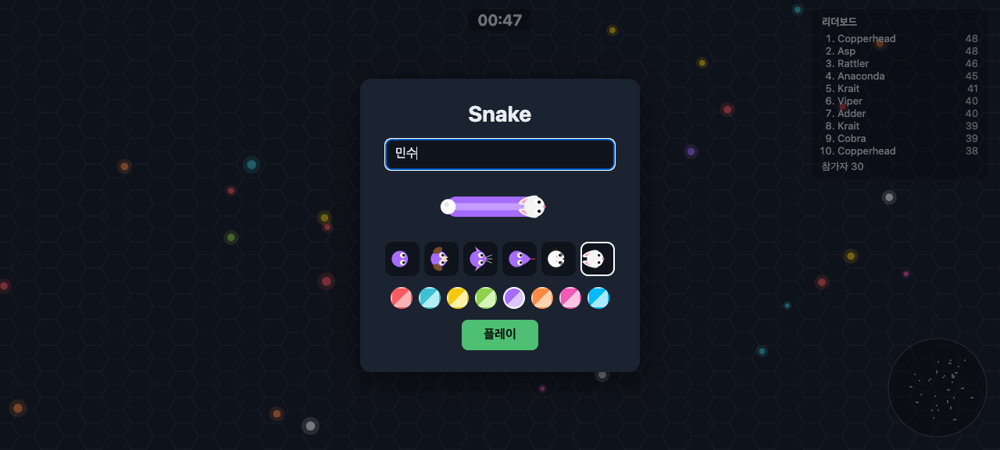
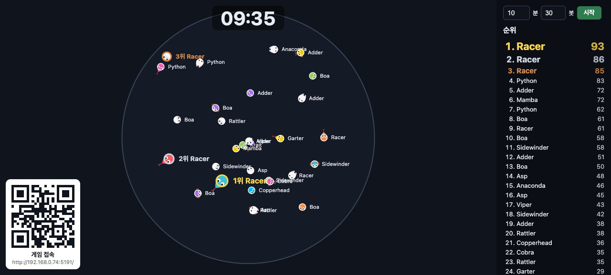
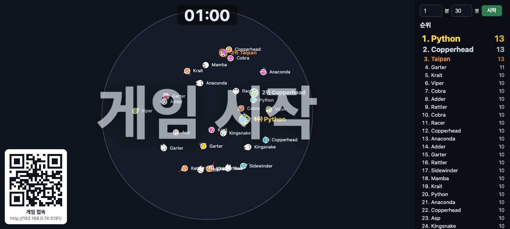
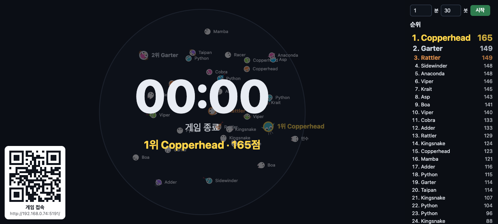
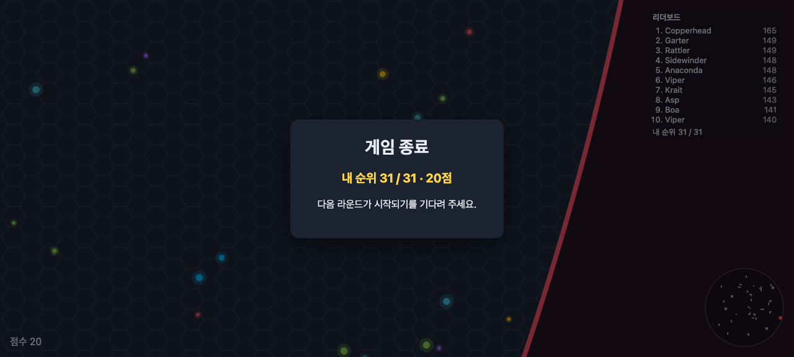

# Snake

slither.io 메커니즘을 참고해 독자적으로 구현한 멀티플레이 뱀 게임입니다. 권위 서버(Node.js + `ws`)와 HTML5 Canvas 클라이언트(Vite)로 구성되며, 서버 봇 30마리가 기본으로 함께 돌아갑니다(봇 수는 관전 화면에서 0~100마리로 바꿀 수 있습니다).

- 스택: Node.js, TypeScript, `ws`, Canvas 2D, Vite, Vitest
- 구조: npm workspaces 모노레포

| 패키지 | 역할 |
|---|---|
| `packages/shared` | 서버·클라이언트 공용 상수, 물리, 프로토콜 |
| `packages/server` | 게임 월드, 봇, WebSocket 서버 (기본 `ws://localhost:8080`) |
| `packages/client` | 브라우저 클라이언트 (기본 `http://localhost:5173`) |
| `scripts` | 부하 테스트 |

설계 문서는 [`docs/superpowers/specs/2026-10-15-snake-clone-design.md`](docs/superpowers/specs/2026-10-15-snake-clone-design.md)에 있습니다.

## 사전 준비

- Node.js 20 이상 (npm 포함)
- [Task](https://taskfile.dev) (`task` 명령)

### Task 설치

이 프로젝트의 실행 명령은 `Taskfile.yml`에 정의되어 있어 `task`가 필요합니다. 설치 후 `task --version`으로 확인하세요.

| 환경 | 명령 |
|---|---|
| macOS (Homebrew) | `brew install go-task` |
| npm (모든 OS) | `npm install -g @go-task/cli` |
| Windows (winget) | `winget install Task.Task` |
| Linux / 기타 | `sh -c "$(curl --location https://taskfile.dev/install.sh)" -- -d -b ~/.local/bin` |

Homebrew의 패키지 이름은 `task`가 아니라 `go-task`입니다. 그 외 방법은 [공식 설치 문서](https://taskfile.dev/installation/)를 참고하세요.

Task 없이 쓰려면 아래 표의 "내부 명령"을 `npm`으로 직접 실행하면 됩니다.

## 실행

```bash
task dev
```

의존성 설치(`task install`)가 먼저 자동 실행되고, 서버와 클라이언트 개발 서버가 함께 뜹니다. 브라우저에서 <http://localhost:5173> 을 열고 이름을 입력해 시작합니다.

```
task dev → install(변경 시에만) → 서버 :8080 + 클라이언트 :5173 동시 실행
```

### 조작

| 입력 | 동작 |
|---|---|
| 마우스 이동 | 진행 방향 |
| 마우스 클릭 / `Space` (누르고 있기) | 부스트 |
| `←` / `→` | 방향 회전 |

시작 화면에서 닉네임과 동물(머리·꼬리 모양), 스킨(색)을 고르고 **플레이**를 누릅니다.



## 관전 화면과 라운드 (`/status`)

<http://localhost:5173/status> 를 열면 게임에 참가하지 않고 월드 전체를 지켜볼 수 있고, 같은 화면에서 시간제한 **라운드**를 시작합니다. 라운드를 시작하기 전에는 기존처럼 월드가 상시 진행됩니다.



| 위치 | 내용 |
|---|---|
| 오른쪽 상단 | 라운드 시간(분, 0~60, 기본 10) · 봇 수(0~100, 기본 30) · **시작** 버튼. 시간을 0분으로 하고 시작하면 시간 제한 없는 자유 게임이 새로 시작됩니다(점수는 0에서 다시 시작, 봇 수는 입력값으로 맞춤) |
| 오른쪽 | 전체 순위 (상위 3명은 금·은·동 강조) |
| 위쪽 가운데 | 남은 시간 카운트다운 |
| 왼쪽 하단 | 게임 접속 주소 QR코드 |

### 라운드 동작

- **시작**을 누르면 모든 뱀(봇 포함)이 새 뱀으로 바뀌어 점수와 길이가 처음 상태로 돌아갑니다. 플레이어에게 사망 화면은 뜨지 않고, 화면 가운데에 "게임 시작"이 1.5초간 크게 나타납니다.
- 봇 수는 시작할 때 적용됩니다. 진행 중에 **시작**을 다시 누르면 새 라운드로 재시작합니다.
- 시간이 `00:00`이 되면 월드가 정지하고 새 참가는 거부됩니다. 관전 화면 가운데에 큰 `00:00`과 "게임 종료", 1위 이름·점수가 표시되며 순위는 최종 점수로 고정됩니다.
- 플레이어 화면에는 남은 시간이 표시되고, 종료되면 내 순위가 나옵니다. 종료 시점에 이미 죽어 있었다면 "탈락 · 최종 점수"가 나옵니다.

```
라운드 없음(상시 진행) ─ 시작 → 진행 중(카운트다운) ─ 00:00 → 종료(월드 정지)
                              ↑                              │
                              └────────── 시작(재시작) ───────┘
```

| 시작 직후 (관전 화면) | 종료 (관전 화면) |
|---|---|
|  |  |



### QR코드로 접속하기

왼쪽 하단 QR코드를 휴대폰으로 스캔하면 게임 페이지가 열립니다. `localhost`로 연 관전 화면에서는 서버가 알려 준 이 PC의 LAN 주소(IPv4)로 바꿔 보여 주고, 이미 IP나 도메인으로 열었다면 그 주소를 그대로 씁니다. `packages/client/.env`에 `VITE_GAME_URL`을 넣으면 이 규칙 대신 그 주소를 보여 줍니다(개발 서버 재시작 필요). QR 아래의 글자가 실제 주소입니다.

- 네트워크 인터페이스가 여러 개이면 첫 번째 주소를 씁니다. VPN이나 가상 어댑터가 먼저 잡히면 휴대폰에서 열리지 않을 수 있습니다.
- 휴대폰이 같은 네트워크에 있어야 하고, 서버(`8080`)와 클라이언트(`5173`) 포트가 방화벽에서 허용되어야 합니다.

### 주의

라운드 컨트롤에는 접근 제한이 없습니다. 관전 화면 주소를 아는 사람은 누구나 라운드를 시작하거나 재시작할 수 있으므로, 외부에 공개하는 환경에서는 사용하지 마세요.

## 서버 중단

### 포그라운드로 실행 중일 때

`task dev`를 실행한 터미널에서 `Ctrl+C`를 누르면 서버와 클라이언트가 함께 종료됩니다. `task server` / `task client`로 따로 띄웠다면 각 터미널에서 `Ctrl+C`를 누르세요.

### 백그라운드 또는 터미널을 잃어버렸을 때

터미널이 닫혔는데 프로세스가 남아 포트가 점유된 경우, 포트로 프로세스를 찾아 종료합니다. (`Taskfile.yml`에는 중단용 task가 없습니다.)

```bash
# 어떤 프로세스가 쓰고 있는지 확인
lsof -i :8080 -i :5173

# 서버(8080)와 클라이언트(5173) 종료
lsof -ti :8080 | xargs kill
lsof -ti :5173 | xargs kill
```

`kill`로 종료되지 않을 때만 `kill -9`를 사용하세요. 서버를 `PORT` 환경 변수로 다른 포트에 띄웠다면 해당 포트 번호로 바꿔서 실행합니다.

```
Ctrl+C 가능? ─ 예 → Ctrl+C
      └ 아니오 → lsof -ti :포트 → kill → 안 죽으면 kill -9
```

## Task 명령 목록

`task --list`로도 확인할 수 있습니다.

| 명령 | 설명 | 내부 명령 |
|---|---|---|
| `task install` | 의존성 설치 (package.json/lock 변경 시에만 실행) | `npm install` |
| `task dev` | 서버(봇 포함)와 클라이언트를 함께 실행 | `npm run dev` |
| `task server` | 게임 서버만 실행 | `npm run start -w @snake/server` |
| `task client` | 클라이언트 개발 서버만 실행 | `npm run dev -w @snake/client` |
| `task test` | 전체 테스트 | `npm test` |
| `task typecheck` | 전체 패키지 타입 검사 | `npm run typecheck` |
| `task build` | 클라이언트 프로덕션 빌드 (`packages/client/dist`) | `npm run build -w @snake/client` |
| `task loadtest -- 100 60` | 부하 테스트 (클라이언트 100명, 60초) | `npm run loadtest -- 100 60` |
| `task check` | 커밋 전 검증 (테스트 + 타입 검사 + 빌드) | — |

## 설정

루트의 `.env.sample`을 `.env`로 복사하고 `PORT`를 변경하면 서버와 클라이언트의 WebSocket 포트에 함께 적용됩니다. 변경 후 실행 중인 개발 서버를 재시작하세요. `.env`는 git에 올리지 않습니다.

```bash
cp .env.sample .env
# .env에서 PORT=9000 등으로 변경
task dev
```

| 환경 변수 | 대상 | 기본값 | 설명 |
|---|---|---|---|
| `PORT` | 서버·클라이언트 | `8080` | 루트 `.env`에서 WebSocket 포트 설정. 셸 환경 변수가 우선 |
| `VITE_WS_URL` | 클라이언트 | `ws://<접속 호스트>:8080` | 접속할 서버 주소 |
| `VITE_GAME_URL` | 클라이언트 | 접속 주소 (localhost면 LAN 주소) | 관전 화면 QR코드에 표시할 게임 주소. `packages/client/.env.sample`을 `.env`로 복사해 설정 (`.env`는 git에 올리지 않음) |

```bash
# 다른 포트로 서버를 띄우고 클라이언트가 그쪽에 붙게 하기
PORT=9000 task server
VITE_WS_URL=ws://localhost:9000 task client
```

클라이언트 개발 서버는 `host: true`로 열리므로 같은 네트워크의 다른 기기에서 `http://<내 IP>:5173`으로 접속해 함께 플레이할 수 있습니다. 관전 화면의 QR코드를 쓰면 주소를 직접 입력하지 않아도 됩니다.
