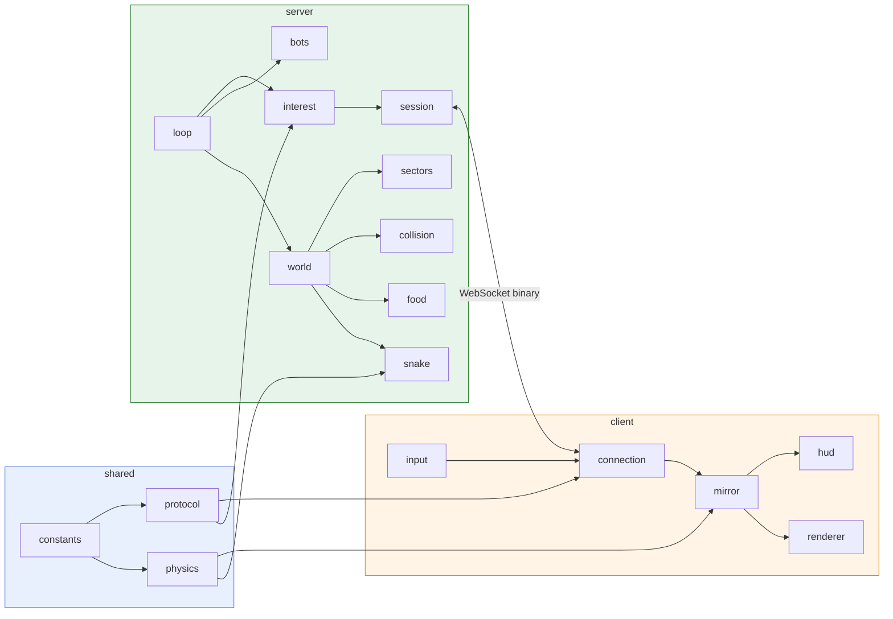
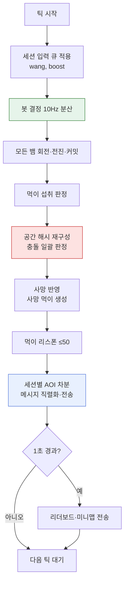

# Snake 클론 설계 스펙 (slither.io 메커니즘 기반 독자 구현)

- 작성일: 2026-10-15
- 상태: 사용자 검토 대기
- 브랜치: `feature/snake-clone`

## 1. 목적과 범위

slither.io의 공개 클라이언트를 정적 분석해 얻은 게임 메커니즘을 바탕으로, **서버와 클라이언트를 독자적으로 구현한 멀티플레이 뱀 게임**을 만든다. 원본 코드·에셋·프로토콜 바이트 포맷은 복제하지 않는다. 분석은 동작 이해에만 사용하고, 코드·프로토콜·그래픽은 모두 새로 작성한다.

사용자가 확정한 사항:

| 항목 | 결정 |
|---|---|
| 목표 | 독자 구현 클론 (원본 클라이언트와의 프로토콜 호환은 목표 아님) |
| 스택 | Node.js + TypeScript, `ws`, HTML5 Canvas 2D, Vite |
| MVP 범위 | 핵심 플레이, 리더보드 + 미니맵, 서버 봇, 단일 서버 다중 접속자 부하 최적화 |
| 네트워크 모델 | 권위 서버 + 원본식 "세그먼트 이벤트" 전송 + 클라이언트 외삽 (승인된 수정안 A) |

성공 기준:

1. 브라우저 2개 이상으로 같은 서버에 접속해 서로 보고, 먹고, 충돌로 죽을 수 있다.
2. 봇 30마리가 있는 월드에서 사람 혼자서도 게임이 성립한다.
3. 동시 접속 헤드리스 클라이언트 100 + 봇 30 부하에서 서버 틱 평균 ≤ 10 ms, 클라이언트당 평균 송신 ≤ 10 KB/s (§12 부하 테스트로 측정).
4. 모든 프로토콜 메시지가 인코드→디코드 왕복 테스트를 통과하고, 클라이언트가 재구성한 몸통 점이 서버 점과 일치한다(오차 ≤ 1e-3).

## 2. 원본 분석 요약

분석 대상: `https://slither.io/s/game1107249518.js` (224,092 bytes, 2026-10-15 수집). REA CLI 정적 분석 Evidence `ev_055b15904d4fada37bafe31ebf846d27ffdaebc067933333c53e7c17ac246ec1` (파싱 80,967 AST 노드, 실패 0, 시맨틱 그래프는 20,000 노드 상한으로 partial). 메커니즘 해석은 해당 파일의 직접 판독에 근거한다. 정적 분석이며 실행 관찰이 아니다.

### 2.1 관찰 (코드에서 직접 확인)

- **전송**: 바이너리 WebSocket `ws://ip:port/slither`. 서버→클라이언트 패킷 44종, 첫 바이트 뒤 1바이트 명령 문자로 구분.
- **초기화 패킷**: 서버가 월드 반경 `grd`, 최대 세그먼트 `mscps`, `sector_size`, 회전 계수 `mamu`, 속도 `nsp1/nsp2/nsp3`, 세그먼트 간격 `msl` 등을 내려줌. 클라이언트 내장값(`grd=16384`, `sector_size=480`, `nsp1=4.25`, `nsp2=.5`, `nsp3=12`, `mamu=.033`, `spangdv=4.8`, `default_msl=42`)은 기본값.
- **입력**: 진행 각도를 1바이트로 양자화해 변경 시에만 전송, 250 ms 간격 핑.
- **몸통 이동**: 몸통은 간격 `msl`의 이산 점 열. 머리가 한 간격 이동할 때마다 이벤트 1개 — 이동(머리 추가 + 꼬리 제거) 또는 성장(머리 추가 + 성장 분수 `fam` 갱신). 신규 프로토콜은 이전 점 + 각도×`msl`로 좌표를 복원.
- **이벤트 사이**: 클라이언트가 각도·목표각·속도로 머리를 외삽.
- **크기 공식**: `sc = min(6, 1 + (sct−2)/106)`, `scang = 0.13 + 0.87·((7−sc)/6)²`, `ssp = nsp1 + nsp2·sc`, `spang = min(1, sp/spangdv)`.
- **이동량**: 8 ms 프레임당 `sp/4` 유닛 → 초당 `31.25·sp`. 회전: 프레임당 `mamu·scang·spang` → 초당 `4.125·scang·spang` rad.
- **점수**: `fmlts[i] = (1 − i/mscps)^2.25`, `fpsls[i] = fpsls[i−1] + 1/fmlts[i−1]`, `score = floor((fpsls[sct] + fam/fmlts[sct] − 1)·15 − 5)`.
- **공간 분할**: 먹이는 섹터 단위로 전송, 먹이 ID = `sx<<24 | sy<<16 | rx<<8 | ry`(섹터 내 위치 1바이트).
- **기타**: 리더보드, 미니맵(RLE 비트맵), 사망, 킬 수, 움직이는 먹이(prey), 아레나 축소.

### 2.2 추론 [중간]

원본 서버는 틱 스냅샷 방식이 아니라 **세그먼트 단위 이벤트 방식**이며, 이것이 대역폭 효율의 핵심이다.

### 2.3 알 수 없음 → 본 설계에서 독자 결정

서버 충돌 판정 반경, 봇 존재/행동, 먹이 리스폰 밀도, 시작 길이, 부스트 비용. 클라이언트 코드에는 이 정보가 없다. 해당 값은 §4 상수표에 "독자 결정"으로 표시한다.

## 3. 아키텍처

npm workspaces 모노레포로 세 패키지를 둔다. `shared`는 서버·클라이언트가 함께 쓰는 상수, 프로토콜 코덱, 물리 공식을 담아 **양쪽이 같은 코드로 계산**하게 한다. 서버는 30 Hz 권위 시뮬레이션과 관심 영역(AOI) 기반 전송을, 클라이언트는 상태 미러·외삽·렌더링·입력을 담당한다. 봇은 서버 내부에서 사람과 같은 입력 인터페이스(목표 각도, 부스트)를 사용한다.

```
packages/
  shared/src/
    constants.ts     게임 상수 (§4)
    physics.ts       크기·속도·회전·점수·줌 공식, 각도 양자화
    protocol.ts      opcode, 메시지 타입, 바이너리 인코더/디코더
  server/src/
    index.ts         HTTP + WebSocket 서버 기동
    loop.ts          고정 틱 루프 (30 Hz)
    game/world.ts    월드 상태, 스폰, 사망 처리
    game/snake.ts    뱀 상태와 이동·커밋·성장·부스트
    game/food.ts     먹이 저장소 (섹터별), 리스폰
    game/collision.ts 몸통 점 공간 해시, 충돌 판정
    game/sectors.ts  섹터 ↔ 뱀/먹이 인덱스
    net/session.ts   접속 1개의 상태 (가시 섹터·가시 뱀, 입력 검증)
    net/interest.ts  AOI 차분 계산과 메시지 생성
    bots/bot.ts      봇 의사결정
  client/
    index.html
    src/main.ts          진입점, 화면 전환
    src/net/connection.ts WebSocket, 디코드, 재접속 UI
    src/state/mirror.ts  서버 상태 미러 + 외삽
    src/render/renderer.ts 카메라, 배경, 먹이, 뱀
    src/ui/hud.ts        리더보드, 미니맵, 점수
    src/input.ts         마우스/키보드 → 각도·부스트
scripts/loadtest.ts      헤드리스 부하 테스트
```

모듈 간 관계는 아래와 같다.



## 4. 게임 상수

좌표계: 월드는 원형, 중심 `(R, R)`, 좌표 범위 `[0, 2R]`. "원본"은 §2.1에서 관찰한 값, "독자 결정"은 초기값이며 플레이 테스트로 조정한다.

| 상수 | 값 | 근거 |
|---|---|---|
| `TICK_HZ` | 30 | 독자 결정 |
| `WORLD_RADIUS` (R) | 8000 | 독자 결정 (원본 16384는 봇 30 + 소규모 인원에 너무 넓음; 섹터 34개/변으로 u8 섹터 좌표에 들어감) |
| `SECTOR_SIZE` | 480 | 원본 |
| `SECTORS_PER_EDGE` | 34 (= ceil(2R/480)) | 파생 |
| `SEG_SPACING` (msl) | 42 | 원본 기본값 |
| `MSCPS` | 411 | 독자 결정 (점수 곡선 파라미터) |
| `MAX_SEGMENTS` | 300 | 독자 결정 (곡선이 `MSCPS` 근처에서 발산하므로 그 전에 상한) |
| `START_SEGMENTS` | 2 | 독자 결정 — 원본 공식으로 시작 점수 10이 되는 값 |
| `NSP1`, `NSP2`, `BOOST_SP` | 4.25, 0.5, 12 | 원본 (`nsp3`를 부스트 속도로 해석 [중간]) |
| `SPEED_SCALE` | 31.25 유닛/s per sp | 원본 프레임 단위 환산 |
| `MAMU` | 0.033 → 4.125 rad/s | 원본 |
| `SPANGDV` | 4.8 | 원본 |
| `BODY_RADIUS(sc)` | `14·sc` | 독자 결정 |
| `BOOST_COST` | 0.8 세그먼트/s | 독자 결정 |
| `BOOST_RECYCLE` | 0.6 (소모량의 60%를 꼬리 먹이로 배출) | 독자 결정 |
| `NATURAL_FOOD_TARGET` | 4000 | 독자 결정 |
| `FOOD_RESPAWN_PER_TICK` | 50 | 독자 결정 |
| `BOT_TARGET` | 30 | 독자 결정 |

## 5. 게임 메커니즘

### 5.1 뱀 상태

서버의 뱀은 다음을 가진다: `id(u16)`, `name`, `skin(u8)`, 커밋된 몸통 점 배열 `points`(꼬리→머리 순, 간격 `SEG_SPACING`, 각 점은 좌표와 자신을 만든 양자화 각도 `iang`을 보관), 연속 머리 위치 `head`, 현재 각도 `ang`, 목표 각도 `wang`, 부스트 여부, 성장 분수 `fam ∈ [0,1)`, 킬 수.

- 세그먼트 수 `sct = points.length`.
- 크기·속도·회전은 `shared/physics.ts`의 원본 공식(§2.1)으로 계산한다. `sp = boosting ? BOOST_SP : NSP1 + NSP2·sc`, 초당 이동 = `SPEED_SCALE·sp`, 초당 최대 회전 = `4.125·scang·min(1, sp/SPANGDV)`.
- 점수 = 원본 공식, `sct`는 `MAX_SEGMENTS`로 상한. 상한 도달 후 성장분은 `fam`이 0.999에서 멈춘다. 검산값(MSCPS 411): 세그먼트 2 → 10, 10 → 133, 100 → 2,029, 300 → 20,245 (u24 범위 내). 이때 `sc` 최대 ≈ 3.81.

### 5.2 이동과 커밋

매 틱(Δt = 1/30 s) 각 뱀에 대해:

1. `ang`를 `wang` 쪽으로 최대 회전량만큼 회전.
2. `head += (cos ang, sin ang) · 속도 · Δt`.
3. 마지막 커밋 점 `P`와 `head` 거리 ≥ `SEG_SPACING`이면 커밋한다. 새 점 = `P + SEG_SPACING · (cos q, sin q)`, `q`는 `atan2(head − P)`를 u16으로 양자화한 각도. 서버도 **양자화된 각도로 점을 만들어** 클라이언트가 각도만 받고 같은 좌표를 재구성하게 한다.
4. 커밋 시 `fam ≥ 1`이면 `fam −= 1`, 꼬리 유지 → `SNAKE_GROW` 이벤트. 아니면 꼬리 제거 → `SNAKE_MOVE` 이벤트.

속도 상한 375 유닛/s에서 틱당 이동 12.5 < 42이므로 틱당 커밋은 최대 1회다.

```
틱 시작 → 회전(ang→wang) → 머리 전진 → |head−P| ≥ 42 ?
                                         ├ 아니오 → 끝
                                         └ 예 → 양자화 각도로 새 점 → fam ≥ 1 ? → GROW : MOVE(꼬리 제거)
```

### 5.3 먹기·성장·부스트

- **먹기**: 머리와 먹이 중심 거리 < `BODY_RADIUS + 25`이면 먹는다. `fam += 먹이.value`.
- **자연 먹이**: 크기 `size ∈ [1,4]`, `value = size·0.05`.
- **사망 먹이**: 사망한 뱀의 각 몸통 점 위치(±10 지터)에 `size 8`, `value 0.4` 먹이 1개.
- **부스트**: `sct > START_SEGMENTS`일 때만 허용. 부스트 중 `fam −= BOOST_COST·Δt`. `fam < 0`이면 꼬리 점 제거, `fam += 1`, `SNAKE_SHRINK` 이벤트. 0.25 s마다 꼬리 위치에 `value = BOOST_COST·0.25·BOOST_RECYCLE` 먹이 배출. 길이가 `START_SEGMENTS`에 도달하면 부스트 자동 해제.

### 5.4 충돌과 사망

- 서로 다른 뱀 A, B에 대해, A의 머리와 B의 몸통 점(머리 포함) 거리 < `0.6·rA + rB`이면 A 사망. 자기 몸과는 충돌하지 않는다(원본 동작과 같음).
- 머리끼리 닿으면 양쪽이 각자 판정되므로 둘 다 죽을 수 있다.
- 월드 경계: 머리의 중심 거리 + `rA` > R이면 사망.
- 사망 처리: 사망 먹이 생성 → 가해자 킬 수 +1 → 뷰어들에게 `SNAKE_REMOVE(reason=died)` → 본인에게 `DEATH`.
- 판정 순서: 한 틱 안에서 모든 뱀 이동 후 충돌 판정을 일괄 수행하고, 사망을 마지막에 반영한다(처리 순서에 따른 불공정 제거).

### 5.5 스폰

중심에서 `0.7R` 이내 임의 위치 중, 모든 몸통 점과 300 이상 떨어진 곳을 최대 20회 시도로 찾는다. 실패 시 마지막 후보를 사용한다. 초기 각도는 임의다. 꼬리 점을 진행 반대 방향 `42·(START_SEGMENTS−1)` 거리에 두고, 양자화된 초기 각도로 `nextPoint`를 반복 적용해 나머지 점을 만든다(모든 점이 §7 재구성 규칙을 만족하도록).

## 6. 서버 틱 루프

틱마다 입력 반영 → 봇 결정 → 시뮬레이션 → 충돌 → 사망 처리 → 먹이 리스폰 → AOI 기반 메시지 전송 순으로 처리한다. 봇 결정은 비용을 줄이기 위해 봇마다 3틱에 한 번(10 Hz), 봇 ID로 분산해 실행한다. 리더보드는 1초마다, 미니맵은 1초마다 전송한다.



틱 스케줄링은 `setTimeout` 대신 목표 시각 누적 방식으로 드리프트를 보정하고, 틱이 50 ms를 넘으면 경고 로그를 남긴다.

### 6.1 공간 인덱스

- **충돌용 공간 해시**: 셀 크기 160. 매 틱 모든 몸통 점을 다시 넣는다(뱀 130마리 × 평균 100점 ≈ 13,000 삽입, 무시 가능한 비용). 머리 기준 반경 `rA + rMax` 원과 겹치는 셀만 조회한다.
- **섹터 인덱스(AOI용)**: 섹터 → (뱀 ID → 그 섹터에 있는 점 수) 맵. 커밋·꼬리 제거 시 증감하고, 0이 되면 제거한다. 먹이는 섹터별 맵 `Map<id, Food>`에 저장한다.

## 7. 네트워크 프로토콜

모든 메시지는 바이너리이며, 서버는 **틱당 접속별로 WebSocket 프레임 1개**에 여러 메시지를 이어 붙여 보낸다. 각 메시지는 `[opcode u8][payload]`이고, 각 opcode의 payload 길이는 고정이거나 payload 안의 개수 필드로 결정된다. 정수는 빅엔디언.

인코딩 규칙:

| 값 | 인코딩 |
|---|---|
| 몸통 점 | 꼬리 앵커 `f64` 2개 + 점마다 양자화 각도 `u16` (모든 점이 `이전 점 + 42·방향(iang)` 규칙을 따르므로 각도만으로 정확히 복원) |
| 각도 | `u16 = round(a·65536/2π) mod 65536` / 입력은 `u8`(2π/256) |
| 속도 | `u8 = round(유닛/s ÷ 2)` |
| `fam` | `u16 = round(fam·65535)` |
| 먹이 ID/위치 | `sx u8, sy u8, rx u8, ry u8` (섹터 내 위치 = r·480/256) |
| 문자열 | `len u8` + UTF-8, 이름 최대 24바이트 |

### 7.1 클라이언트 → 서버

| opcode | 이름 | payload |
|---|---|---|
| 0x01 | JOIN | `nameLen u8, name, skin u8` |
| 0x02 | STEER | `angle u8` (변경 시에만, 최대 30회/s) |
| 0x03 | BOOST | `on u8` |
| 0x04 | PING | 없음 |

### 7.2 서버 → 클라이언트

| opcode | 이름 | payload |
|---|---|---|
| 0x10 | WELCOME | `selfId u16, worldRadius u16, sectorSize u16, segSpacing u8, tickHz u8, mscps u16, maxSegments u16` |
| 0x11 | SNAKE_ADD | `id u16, name, skin u8, ang u16, wang u16, speed u8, fam u16, n u16, tailX f64, tailY f64, (n−1)×iang u16` — 꼬리 앵커만 f64로 정확히 보내고, 이후 점은 `nextPoint(prev, iang)`로 재구성 (오차 누적 없음) |
| 0x12 | SNAKE_REMOVE | `id u16, reason u8` (0 = 시야 이탈, 1 = 사망) |
| 0x13 | SNAKE_MOVE | `id u16, iang u16` — 새 머리 점 = 이전 머리 점 + 42·(cos, sin), 꼬리 제거 |
| 0x14 | SNAKE_GROW | `id u16, iang u16, fam u16` — 꼬리 유지 |
| 0x15 | SNAKE_SHRINK | `id u16, fam u16` — 꼬리 점 1개 제거 |
| 0x16 | SNAKE_STATE | `id u16, ang u16, wang u16, speed u8` — `wang`/속도 변경 시, 뱀당 틱당 최대 1회 |
| 0x17 | SNAKE_FAM | `id u16, fam u16` — 먹이로 `fam`이 변했을 때, 뱀당 틱당 최대 1회 |
| 0x20 | SECTOR_FOOD | `sx u8, sy u8, count u8, count×(rx u8, ry u8, size u8, color u8)` — 섹터 진입 시 전체 |
| 0x21 | FOOD_ADD | `sx, sy, rx, ry, size u8, color u8` |
| 0x22 | FOOD_EAT | `sx, sy, rx, ry, eaterId u16` |
| 0x23 | SECTOR_LEAVE | `sx u8, sy u8` — 클라이언트가 해당 섹터 먹이 삭제 |
| 0x30 | LEADERBOARD | `myRank u16, total u16, n u8, n×(score u24, name)` |
| 0x31 | MINIMAP | 64×64 점유 비트맵 512바이트 (전원 공통 버퍼를 1회 생성해 공유) |
| 0x32 | DEATH | `killerId u16` (0xFFFF = 경계), `finalScore u24` |
| 0x33 | PONG | 없음 |

머리 점 재구성은 서버·클라이언트 모두 `shared/physics.ts`의 같은 함수 `nextPoint(prev, iang)`를 사용한다. 섹터당 먹이가 255개를 넘으면 `SECTOR_FOOD`를 여러 개로 나눈다. 같은 위치 ID에 먹이가 있으면 스폰을 재시도한다.

### 7.3 대역폭 추정

`SNAKE_MOVE` 5바이트. 보통 속도 148 유닛/s ÷ 42 ≈ 초당 3.5회 커밋, 부스트 시 약 9회. 가시 뱀 30마리 기준 ≈ 30 × 5회 × 5 B ≈ 0.75 KB/s, WebSocket 프레임 오버헤드 30 프레임 × ~4 B, 리더보드·미니맵 ≈ 0.7 KB/s. 합계 약 2 KB/s로 목표 10 KB/s 이내다. 실측은 §12 부하 테스트로 확인한다.

## 8. 관심 영역(AOI)

세션마다 "가시 섹터 집합"과 "가시 뱀 집합"을 유지하고, 매 틱 새 집합과의 차분만 전송한다.

- 가시 반경 = `viewRadius(sc) = 1100 · zoom(sc) + 200`, `zoom(sc) = 1 + 0.25·(sc − 1)`. 클라이언트 카메라도 같은 `zoom(sc)`를 써서 화면과 AOI가 맞는다.
- 가시 섹터 = 자기 머리 섹터 중심으로 `k = ceil(viewRadius / 480)` 범위의 정사각형 중 월드 원과 겹치는 섹터.
- 가시 뱀 = 가시 섹터 중 하나라도 점이 있는 뱀.
- 새로 보이는 섹터 → `SECTOR_FOOD`, 사라진 섹터 → `SECTOR_LEAVE`. 새로 보이는 뱀 → `SNAKE_ADD`, 사라진 뱀 → `SNAKE_REMOVE(0)`.
- 이벤트(이동·성장·먹이 변화)는 가시 뱀/가시 섹터에 해당할 때만 그 세션에 전송한다.
- 사망 후 관전 단계에서는 사망 위치 기준으로 가시 집합을 유지하다가 재참가 시 새 위치로 갱신한다.

접속 수명주기:

```
접속 → WELCOME → (JOIN 대기) → JOIN → 스폰 → SNAKE_ADD(self) + SECTOR_FOOD… → 플레이
  → DEATH → 사망 화면 → JOIN(재참가) → 스폰 …
  → 연결 종료 → 뱀이 있으면 사망 처리와 같게 먹이로 변환
```

## 9. 클라이언트

### 9.1 상태 미러와 외삽

- 미러는 뱀별로 커밋된 점 배열, `ang`, `wang`, 속도, `fam`과 "마지막 커밋 이후 경과 거리" `progress`를 가진다.
- 매 렌더 프레임: `ang`를 공유 회전 공식으로 `wang` 쪽으로 돌리고 `progress += 속도·dt`. 외삽 머리 = 마지막 점 + `min(progress, 1.5·42)`·방향.
- `SNAKE_MOVE/GROW` 수신 시 새 점을 추가하고 `progress = max(0, progress − 42)`. 외삽 머리와 실제 점의 차이는 0.15 s 동안 보간해 튐을 줄인다.
- 꼬리는 `progress/42` 비율만큼 마지막 구간을 따라 미끄러지듯 그려 꼬리 점 제거 시 점프가 보이지 않게 한다.
- **자기 뱀 예측**: 입력 각도를 로컬 `wang`에 즉시 적용해 회전 반응 지연을 없앤다. 위치는 서버 이벤트로 교정한다.

### 9.2 렌더링 (Canvas 2D)

- 카메라: 자기 외삽 머리 중심, 배율 `1/zoom(sc)`, devicePixelRatio 대응.
- 배경: 육각 격자 패턴(오프스크린 캔버스로 1회 생성), 월드 경계 원.
- 먹이: 화면 내 섹터만 순회, 색상별 원 + 글로우(사전 렌더 스프라이트).
- 뱀: 점들을 잇는 경로를 `lineWidth = 2r`, `lineCap = round`로 한 번 스트로크한 뒤, 스킨 색 2개로 일정 간격 줄무늬 원을 덧그린다. 머리에 눈 2개, 부스트 중 외곽 글로우. 원본 그래픽은 사용하지 않는다.
- 이름표: 뱀 머리 근처.

### 9.3 UI와 입력

- 시작 화면: 닉네임 입력, 스킨 8종 중 선택(색 조합), Play 버튼.
- 인게임 HUD: 우상단 리더보드(상위 10 + 내 순위), 우하단 미니맵(64×64 비트맵 + 내 위치 점), 좌하단 길이/점수/킬.
- 입력: 마우스 위치 → 화면 중심 대비 각도. 좌클릭 또는 Space 유지 = 부스트. 화살표 키 좌우로도 회전.
- 사망 화면: 최종 점수, 다시 하기.
- 연결 끊김: 오버레이와 재접속 버튼.

## 10. 봇

봇은 서버 내 `Bot` 객체로, 매 결정 시 `setWang(angle)`, `setBoost(bool)`만 호출한다(사람과 같은 경로). 사람 수와 관계없이 봇이 항상 `BOT_TARGET`마리가 되도록 사망 즉시 보충한다. 이름은 고정 목록에서 무작위로 뽑는다.

의사결정 우선순위(10 Hz):

1. **경계 회피**: 머리가 `R − 600` 밖이면 중심 방향으로 전환.
2. **위험 회피**: 현재 각도 기준 −90°~+90° 범위 9개 방향으로 `150 + 2r` 길이 탐침을 쏘아 공간 해시로 다른 뱀 몸통 점과의 교차를 검사. 현재 방향이 막혀 있으면 가장 멀리 열린 방향으로 전환.
3. **먹이 추적**: 반경 500 내 먹이에 대해 `value / 거리` 점수가 가장 높은 먹이 방향.
4. **배회**: 먹이가 없으면 2~4초마다 무작위 각도.
5. **부스트**: 반경 300 내 사망 먹이 합 value ≥ 1이고 위험이 없을 때만 부스트, 길이가 `START_SEGMENTS + 3` 이하면 금지.

## 11. 오류 처리

| 상황 | 처리 |
|---|---|
| 알 수 없는 opcode, 길이 불일치, 범위 밖 값 | 해당 접속 종료 (WebSocket close 1008) |
| JOIN 전 STEER/BOOST, 플레이 중 JOIN | 무시 |
| 입력 과다 (> 60 메시지/s) | 초과분 폐기, 3초 연속이면 종료 |
| 이름 | 제어 문자 제거, 24바이트 초과 시 절단, 빈 이름은 "Player" |
| 송신 버퍼 적체 (`ws.bufferedAmount`) | 256 KB 초과 시 리더보드·미니맵 생략, 2 MB 초과 시 종료 |
| 틱 처리 50 ms 초과 | 경고 로그, 틱은 건너뛰지 않고 다음 목표 시각을 재설정 |
| 뱀 ID 고갈 | u16 순환 할당, 살아 있는 ID는 건너뜀 |
| 클라이언트 디코드 오류 | 콘솔 오류 + 재접속 오버레이 |

## 12. 테스트 전략

Vitest로 `shared`와 `server`를 단위·통합 테스트하고, 부하 테스트 스크립트와 브라우저 수동 검증으로 마무리한다. TDD로 진행한다.

| 범주 | 검증 내용 |
|---|---|
| 프로토콜 | 모든 opcode 인코드→디코드 왕복 일치, 잘못된 길이 거부 |
| 물리 | `score(2, 0) = 10`, `sc`/`scang`/속도 공식 원본값 일치, 회전 상한 준수 |
| 커밋 동기화 | 서버 1,000스텝 시뮬레이션(회전·성장·부스트 포함) 후, (a) 처음부터 이벤트만 받은 클라이언트와 (b) 중간에 SNAKE_ADD로 합류한 클라이언트가 재구성한 점이 모두 서버 점과 1e-3 이내 일치 |
| 성장·부스트 | 먹이 섭취 → `fam` 증가 → GROW, 부스트 → SHRINK와 꼬리 먹이 배출, 최소 길이에서 부스트 해제 |
| 충돌 | 머리-몸통 사망, 자기 몸 무시, 머리-머리 쌍방, 경계 사망, 일괄 판정의 순서 독립성 |
| 먹이 | 리스폰이 목표 수로 수렴, ID 충돌 재시도, 사망 먹이 개수 = 몸통 점 수 |
| AOI | 섹터 진입/이탈 차분 메시지, 시야 밖 뱀 이벤트 미전송 |
| 봇 | 빈 월드에서 봇 60초 시뮬레이션 동안 경계 사망 0회 |
| 통합 | 실제 서버 기동 → `ws` 클라이언트 JOIN → WELCOME, 자기 SNAKE_ADD, SECTOR_FOOD 수신 |
| 부하 | `scripts/loadtest.ts`: 헤드리스 100명 + 봇 30, 60초, 틱 평균/최대 ms와 클라이언트당 송신량 보고 → 성공 기준 3 |
| 브라우저 | Playwright로 페이지 로드, Play, 캔버스 렌더, 콘솔 오류 0 확인 |

## 13. 실행 방법

- `npm install`
- `npm run dev`: `concurrently`로 서버(`tsx watch`, 포트 8080)와 Vite 클라이언트(포트 5173)를 함께 실행. 클라이언트는 `ws://<호스트>:8080`에 접속.
- `npm test`: 전체 Vitest.
- `npm run loadtest`: 부하 테스트.

의존성: `ws`, `typescript`, `tsx`, `vite`, `vitest`, `concurrently`, `@types/ws`, `@types/node`. 렌더링 라이브러리는 쓰지 않는다.

## 14. 범위 밖

계정·저장소, 다중 룸/서버 샤딩, 팀 모드, 움직이는 먹이(prey), 아레나 축소, 코스메틱·스킨 편집기, 모바일 터치 최적화, TLS/배포, 원본 클라이언트 호환, 서버 권위 외의 치트 방지.

## 15. 열린 사항 (구현 중 튜닝)

- §4의 "독자 결정" 값은 플레이 테스트로 조정한다. 특히 `START_SEGMENTS = 2`는 원본 점수 공식과 맞추기 위한 값이라 시각적으로 짧을 수 있다. 짧으면 점수 오프셋을 보정하고 시작 길이를 늘린다.
- `BOOST_SP = 12`는 원본 `nsp3`를 부스트 속도로 해석한 추론이다 [중간].
